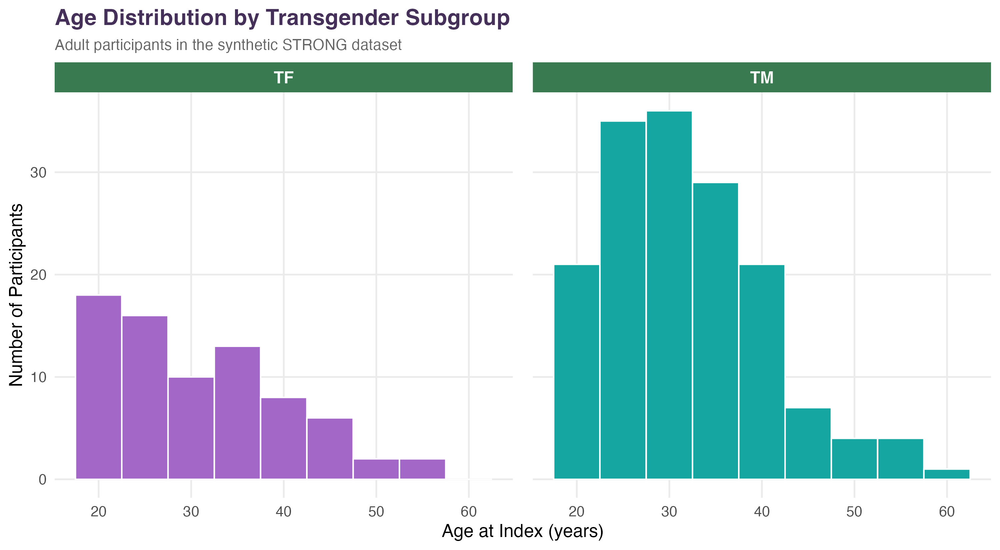

---
title: "Descriptive Analysis of Synthetic STRONG Data"
author: "Madhu Bulusu"
date: "`r Sys.Date()`"
output:
  html_document: default
# output:
#   pdf_document: default
# fontsize: 11pt
---

```{r setup, include=FALSE}
knitr::opts_chunk$set(
  echo = FALSE,
  message = FALSE,
  warning = FALSE
)

library(gtsummary)
library(ggplot2)
library(dplyr)
```

# Introduction

The Study of Transition, Outcomes, and Gender (STRONG) is a study of transgender individuals receiving care across multiple health care systems. For this DATA 550 project, a synthetic data set was created to reflect the structure and selected characteristics of the STRONG data while protecting participant-level information. All observations and values used in this report are simulated and do not represent actual study participants. The synthetic data set contains 300 observations and 24 variables, including demographic characteristics, study site, transgender subgroup, and index date.

Participants are classified into transfeminine (TF) and transmasculine (TM) subgroups. The objective of this analysis is to describe selected demographic characteristics of adult participants in the synthetic data and to examine these characteristics separately for the TF and TM subgroups. The analysis focuses on age at index, study site, race/ethnicity, and administrative sex. This analysis also serves as an initial step in developing a reproducible analytic workflow that can later be applied to the STRONG data for my thesis.

# Data

The synthetic STRONG data set is stored in the local `data/` directory. The adult analytic dataset is prepared using `code/01_prepare_data.R`.

```{r read-data}
analysis_data <- readRDS("output/analysis_data.rds")
```

# Analysis

The analysis was restricted to participants who were 18 years of age or older at their index date and classified as TF or TM. This adult analytic sample was used to describe participant characteristics separately for the two subgroups.

## Participant Characteristics

Table 1 summarizes selected demographic characteristics of the adult synthetic STRONG sample separately for transfeminine (TF) and transmasculine (TM) participants. Age at index is summarized using the mean and standard deviation, while study site, race/ethnicity, and administrative sex are presented as counts and percentages.

```{r table1}
table1 <- readRDS("output/table1.rds")
table1
```

The adult analytic sample included 75 TF participants and 158 TM participants. Mean age at index was similar between the two subgroups, at 31 years among TF participants and 32 years among TM participants. In both groups, more than half of participants were classified as White, and KPNC was the most frequently represented study site. Administrative sex showed a different distribution between the TF and TM subgroups in this simulated sample.

## Age Distribution

Figure 1 shows the distribution of age at index separately for transfeminine (TF) and transmasculine (TM) participants in the adult synthetic STRONG sample.

```{r age-figure, out.width="100%"}

```

Both TF and TM participants were more frequently represented in the younger adult age ranges, with fewer participants at older ages. Figure 1 allows the age distributions of the two subgroups to be compared visually and complements the age summaries presented in Table 1. Because these data are synthetic, these patterns should not be interpreted as findings from the actual STRONG study.
